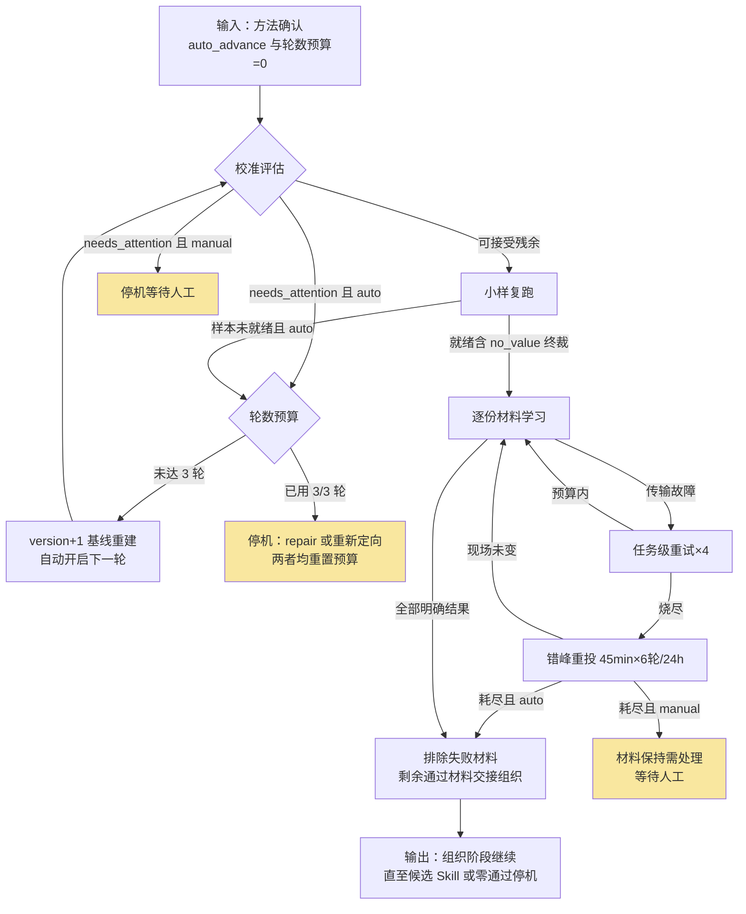

# 专家项目无人值守流水线修复

日期：2026-08-25
性质：设计定稿与实施记录。对应提交 `33eea884`（方法校准多轮有界续跑）、`df2c7183`（材料学习错峰重投）。
本文取代《[专家学习流水线意图共识](2026-08-18-expert-learning-pipeline-intent.md)》第 233 行「模型调用持续失败……进入"需要处理"并阻塞阶段交接」的单次失败即停机语义：运行条件失效先走有界自动恢复，预算内自愈，耗尽后按推进模式分流。

## 一、问题：无人值守承诺被三处单点停机打破

自动推进模式向用户承诺「确认一次后成书到候选 Skill」，但三个真实场景仍会把项目留在 `needs_attention` 等人工：

1. **方法校准只跑一轮**。校准评估判 `needs_attention` 后项目直接停机，而评估本身是模型对「残余问题是否阻碍批量学习」的判断——一次不通过不代表下一轮收敛不了。免费上游分时段不可用时更是必然停机。
2. **repair 门禁死锁**。手动模式中确认后校准失败的项目同时命中「已完成一次校准」「校准已开始」双门，repair 拒绝执行且强制改写 `auto_advance=False`，用户既修不了当前方法也无法回到原推进模式。
3. **单材料学习传输失败即阻塞**。一份材料烧尽 ARQ 任务级重试（4 次）后整项目停在 `needs_attention`，其余已通过的材料全部陪停。

## 二、机制

### 2.1 方法校准：有界续跑替代单轮停机

- 新列 `expert_projects.method_calibration_rounds`（INTEGER NOT NULL DEFAULT 0），记录本确认代际内已失败的校准执行次数；`confirm` / `repair` / 重新定向时重置为 0。
- 自动模式下两个失败出口都进入 `_advance_auto_calibration_round`：
  - 出口一：小样复跑未达 `awaiting_confirmation`（防御性保留；自动终裁下实际不可达）；
  - 出口二：校准评估判 `needs_attention`（真实主路径）。
- 未达上限（`MAX_METHOD_CALIBRATION_ROUNDS = 3`）：`method_version += 1`、`completed_at = None`、基线从当前样本连同 Review 重建、状态回 `running`，返回 `next_method_version` 由 worker 用新版本号重新投递（同 job_id 会被队列去重拒投，必须换版本号）。
- 预算耗尽：停机报错含「已用 3/3 轮」，等人工修复或重新定向；两者都会重置预算。
- 手动模式行为不变：失败即停在 `needs_attention`，由用户决定重跑、排除或 repair。
- prompt 同步去轮次绑定：「唯一一次方法校准」改为「执行一次方法校准」，评估视角从 V1/V2 改为上一轮/本轮，函数合同不变。

### 2.2 repair：只拦在途校准

门禁收窄为一条事实判据：**基线非空 ∧ `completed_at` 为空**（本轮校准正在途）才拒绝，提示恢复当前校准任务。删除双门与 `auto_advance=False` 强改，重置轮数预算——修复后项目保持原有推进模式继续。

### 2.3 小样就绪校验接受 no_value

`_validate_method_samples_ready` 接受 `no_value` 自动终裁对（与交接校验同一口径）：自动模式下小样被判「无迁移价值 + Reviewer 认可」是合法结论，不再当作校准失败。

### 2.4 材料学习：错峰重投 + 耗尽后按模式结算

照抄定向阶段 `ORIENTATION_AUTO_REROLL` 先例（45 分钟 × 6 轮 × 24h TTL）：

- 单材料遇传输类故障烧尽任务级预算后，`_schedule_material_learning_auto_reroll` 按 Redis 计数器安排错峰重投；确定性业务失败（ValueError）不重投。
- 重投到期时校验现场（阶段、版本、项目与材料仍在 `needs_attention`），用户已手工处理过则忽略。
- 预算耗尽后 `_settle_exhausted_material_reroll` 分流：**自动模式**调 `exclude_failed_material_for_auto_advance` 把失败材料按固定原因「运行失败自动排除」（`status=excluded`，与人工排除共用同一套事实语义，但不设「至少保留一份」门槛——排空时由收尾逻辑自然停在「没有材料通过 Review」），剩余通过材料正常交接组织阶段；**手动模式**保持原地等待人工。

## 三、流程全景

自动/人工边界：黄色节点是仅有的人工触点（手动模式全程、自动模式的预算耗尽点）；其余分支全部无人值守。停止条件只有三类——预算耗尽（带「已用 N/N 轮」或重投轮数标注）、确定性业务失败、零份材料通过；输出是组织阶段交接或可行动的停机事实。

## 四、测试锚点

- 服务层：出口二预算耗尽与续跑版本号、过期 V2 任务忽略窗口、repair 放行回归锁（`auto_advance` 保持 + 预算重置）、no_value 就绪校验、手动模式不变。
- Worker 层：校准 wrapper 按新版本号续投、材料调度一轮 defer 投递、reroll handler 拉回与过期忽略、耗尽后 auto 排除（`exclusion_reason`）+ 组织交接、manual 不排除。
